 

 

## About me

Hi, I'm Ashish. I'm a B.Tech CSE student at MMMUT, Gorakhpur, graduating in 2027.

I got into cybersecurity first. Most of my early time went into SOC labs, TryHackMe (top 3% there now), Windows logs and packet captures. Along the way I kept feeling that reading about attacks was not enough, I wanted to build the things I was trying to defend. That is what pushed me towards backend development.

These days my time is split three ways: security tools, backend work in Python, Go and TypeScript, and AI agents. The agent side is fairly recent and honestly the most interesting to me right now, mostly because it brings the other two together. An agent that can call tools is basically a backend with a mind of its own, and it needs the same care with permissions, input checks and logging that any other system does. Probably more.

What I'm up to at the moment:

- Building [MCPGuard](https://github.com/Ashiii27/mcpguard), a small proxy that checks MCP tool calls before they run. It looks for leaked secrets, prompt injection and writes to files that should not be touched.
- Working through LangChain and agent patterns in [agenticLangChain](https://github.com/Ashiii27/agenticLangChain). I mostly care about how agents use tools and where that can go wrong.
- Looking for internships in security, backend or AI engineering, in that area or somewhere in between.

## What I work on

### Security

This is where I started, and I still spend a good amount of time here. Log and PCAP analysis, Windows event logs, writing detections and mapping them to MITRE ATT&CK, that sort of thing. Most of my early repos are home labs and small tools from learning this.

### Backend

Python, Go and TypeScript, usually FastAPI or Express on top. I try to pay attention to the unglamorous parts: auth, validation, rate limits, decent error handling. The [backend-projects](https://github.com/Ashiii27/backend-projects) repo is where a lot of my practice code lives.

### Agentic AI

LangChain agents, MCP and tool calling. My interest here is less about making agents do impressive demos and more about what happens when they are given real access to files, APIs and shells. That is the problem MCPGuard came out of.

## Tools I use

**Languages**

**Backend and APIs**

**Other stuff**

A few more specific ones that do not have neat icons:

| Area | Things I use |
| :--- | :--- |
| AI / agents | LangChain, MCP, Groq and Gemini models, Pydantic for structured output |
| Security | MITRE ATT&CK, Wireshark, Sigma rules, STIX 2.1, JA3 fingerprinting |
| Forensics | EVTX parsing, FTK Imager, Autopsy, Windows registry, timeline work |

## Projects

These are the ones I would point to first. The rest of my repos are mostly notes, labs and things I built while learning.

<table>
<tr>
<td width="50%" valign="top">
<h3><a href="https://github.com/Ashiii27/mcpguard">MCPGuard</a></h3>

A security proxy for the Model Context Protocol, written in Python with no dependencies. It sits between an MCP client and server and checks every tool call before it goes through. If it spots a secret in the arguments, signs of prompt injection, or a write to a sensitive path, the call gets blocked. This started because I could not find a simple way to do this and wanted to see if I could build one.

</td>
<td width="50%" valign="top">
<h3><a href="https://github.com/Ashiii27/honeypot-network">Honeypot Network</a></h3>

A honeypot setup in Go that pretends to be six services at once: SSH, HTTP, FTP, SMB, MySQL and Redis. It records what attackers actually do, credentials they try, commands they run, files they upload, then maps that behaviour to MITRE ATT&amp;CK and pulls out IOCs. There is a React dashboard that streams it live and lets you replay SSH sessions.

</td>
</tr>
<tr>
<td width="50%" valign="top">
<h3><a href="https://github.com/Ashiii27/WinLogin-Forensics">WinLogin Forensics</a></h3>

Parses Windows authentication logs and lines up logons across Local, MSA, RDP and Kerberos so odd access patterns are easier to spot. Works with event IDs 4624, 4625, 4648, 4768 and 4776. I co-authored an IEEE paper based on this work with Dr. Vimal Kumar at MMMUT, which is how this project started.

</td>
<td width="50%" valign="top">
<h3><a href="https://github.com/Ashiii27/SentinelX">SentinelX</a></h3>

A network intrusion detection system in C++. I wrote the packet parsing pipeline myself (capture, then IP, TCP and HTTP) instead of leaning on a library for all of it, mostly to understand what was actually inside a packet. Detectors plug in through a common interface and the alerts come out tagged with severity and ATT&amp;CK techniques.

</td>
</tr>
<tr>
<td width="50%" valign="top">
<h3><a href="https://github.com/Ashiii27/PCAP-Forensics-Analyser">PCAP Forensics Analyser</a></h3>

A command line tool for picking apart packet captures. It rebuilds TCP sessions, pulls IOCs out of HTTP, DNS, FTP and TLS traffic, and flags things like port scans, DNS tunnelling and cleartext logins. It also does JA3 fingerprinting, which is a neat trick I picked up from how real NDR tools identify malware traffic. Output is JSON, so it can feed into other tooling.

</td>
<td width="50%" valign="top">
<h3><a href="https://github.com/Ashiii27/cve-explorer">CVE Explorer</a></h3>

A small web app for searching CVEs with live data from the NVD and Exploit-DB. Nothing fancy, it was one of my earlier full stack builds and a good way to learn how a frontend and an API fit together. It is deployed if you want to click around.

</td>
</tr>
</table>

### Other repos worth a look

| Repo | Notes |
| :--- | :--- |
| [Agentic LangChain](https://github.com/Ashiii27/agenticLangChain) | My LangChain notes and experiments, written from a security angle. Safe tool use, prompt injection, validating model output with Pydantic. |
| [Backend Projects](https://github.com/Ashiii27/backend-projects) | Practice backend work in TypeScript and JavaScript. REST APIs, an Express server, a tested HTTP API. |
| [Exposure](https://github.com/Ashiii27/Exposure) | Shows what a web page gets up to behind your back: trackers, fingerprinting scripts, third party requests, plotted as a graph. Work in progress. |
| [CyberSecurity HomeLabs](https://github.com/Ashiii27/CyberSecurity-HomeLabs-Setup) | The DFIR home lab I set up with a Windows VM and WSL for practising investigations. For whatever reason this is my most starred repo. |

## A bit of background

| | |
| :--- | :--- |
| TryHackMe | Top 3% globally. Mostly SOC and blue team paths. |
| IEEE paper | Co-authored a paper on Windows authentication forensics with Dr. Vimal Kumar, MMMUT. |
| PSB Hackathon 2026 | Built MAFIA at the PSB Cybersecurity Hackathon (IIT Hyderabad and Bank of India), an Android malware and fraud checker with a WhatsApp bot on the front and a dashboard behind it. |
| College | B.Tech CSE, MMMUT Gorakhpur, class of 2027. |

## GitHub stats

&nbsp;

  

  

## Contribution graph

<picture>
  <source media="(prefers-color-scheme: dark)" srcset="assets/github-snake-dark.svg"/>
  <source media="(prefers-color-scheme: light)" srcset="assets/github-snake.svg"/>
  
</picture>

The snake is generated from my actual contribution data and lives in this repo under <code>assets/</code>, so it does not depend on any outside service. It is a snapshot rather than a live feed for now.

## Get in touch

LinkedIn or email is the fastest way to reach me. I read everything, replies might take a day or two if college is busy.

&nbsp;

&nbsp;

 

